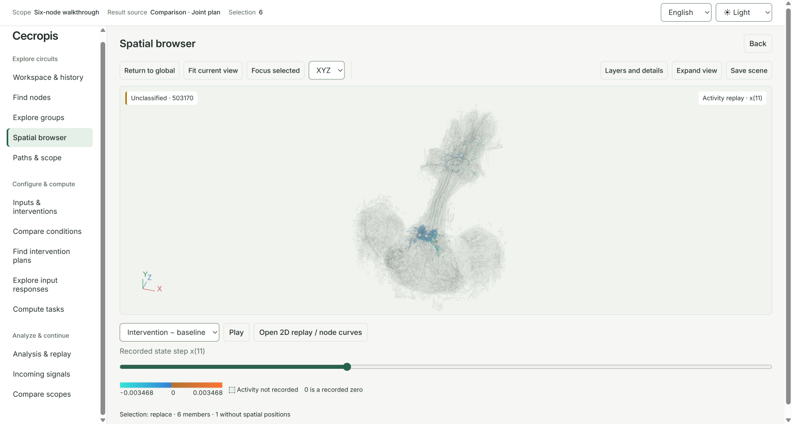
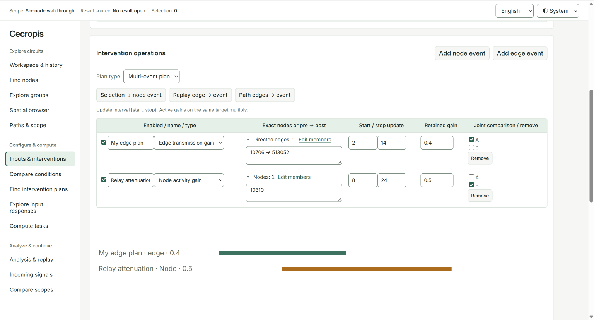
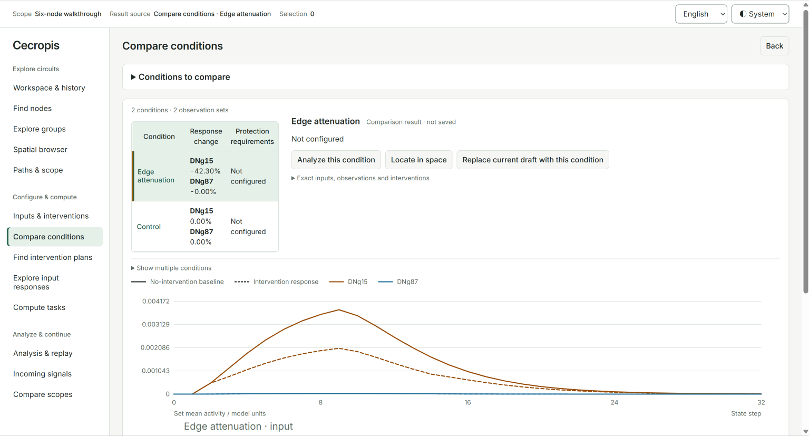
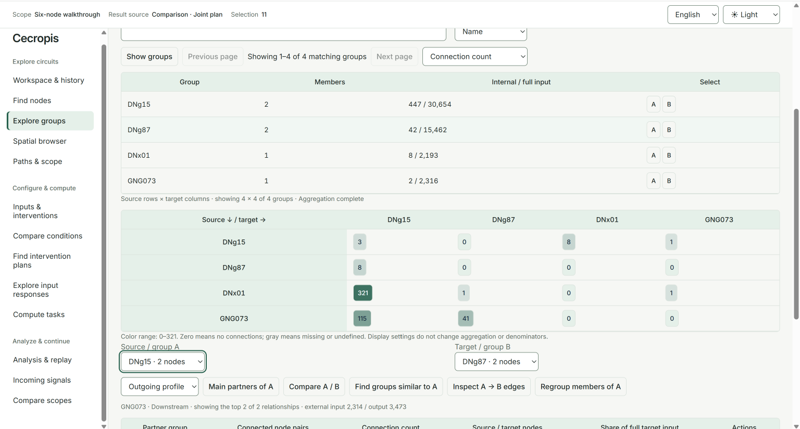

# Cecropis

Cecropis is a local workbench for exploring connectomes and comparing model responses to interventions. Use a browser or the command line to inspect connections, define experiments and examine their results.

The workbench uses **MaleCNS v1.0** directed connectivity and annotations, with optional three-dimensional neuron skeletons. A discrete-time propagation model calculates responses to timed inputs and node or edge interventions. Data and computation stay on your machine; you choose where to store downloaded data and results.



Spatial browser combines a simplified global skeleton overview with recorded model activity. Connectivity and morphology come from [MaleCNS v1.0](docs/reference/data-sources.md), licensed under [CC BY 4.0](https://creativecommons.org/licenses/by/4.0/); activity colors and response curves show the propagation model's output.

## What you can do

- Find neurons, inspect grouped connections and structural similarity, and follow multi-hop pathways.
- Select a calculation scope, inspect its external inputs and compare results across expanded scopes.
- Define timed inputs, observation sets, evaluation windows, and node or directed-edge interventions.
- Compare conditions, search bounded candidate sets under target and protection constraints, and inspect differences and recorded replays.
- Explore real neuron morphology with a global overview and on-demand detail.
- Save results and analysis sessions, export HTML/CSV reports, and share fixed task definitions.

The interface and HTML reports support English, 简体中文, 日本語, Français, Deutsch and Español. The interface defaults to English until you choose another language; your preference is retained. Light, dark and system themes use bundled local fonts.

<details>
<summary>More screenshots: interventions, comparisons and grouped connections</summary>

**Timed interventions.** Combine node and directed-edge events, each with its own gain and update interval.



**Condition comparison.** Inspect observation curves and response changes for each condition against its baseline.



**Grouped connections.** Inspect directed connection counts between neuron groups and compare their connectivity profiles.



These views use MaleCNS v1.0 data. See [data sources](docs/reference/data-sources.md#readme-screenshots) for attribution and how the displayed data was processed.

</details>

## Requirements

- **Python 3.11 or 3.12 recommended.**
- Runtime dependencies: **NumPy, SciPy and PyArrow**. Install them into your Python environment as shown below.
- A modern browser with WebGL for the 3D view.
- Local disk space for data, indexes, optional skeleton caches and results. The two required source files total about 1.07 GB; processed data and temporary files need additional space. See [downloads](docs/guides/downloads.md).

## Set up and run from source

Download and extract the repository's source ZIP, or use your local checkout, then enter the directory containing `cecropis/` and `scripts/`. Create your own Python environment, or use an existing suitable one. Run the commands in this guide from that source directory.

Windows PowerShell:

```powershell
py -3.11 -m venv .venv
.\.venv\Scripts\Activate.ps1
python -m pip install numpy scipy pyarrow
python -m cecropis --version
```

On subsequent visits, enter the source directory and activate the existing environment with `.\.venv\Scripts\Activate.ps1`. Environment creation and dependency installation are only needed for initial setup.

Linux / macOS:

```sh
python3.11 -m venv .venv
. .venv/bin/activate
python -m pip install numpy scipy pyarrow
python -m cecropis --version
```

Use `python3.12` if that is your installed version. On subsequent visits, enter the source directory and select the existing environment again. Continue with data preparation below, then use the complete command in [Start and stop](#start-and-stop). See [first use](docs/guides/first-use.md) for paths and environment details.

## Prepare your data

From the source root, the following commands work in PowerShell or a POSIX shell. They use a separate sibling directory, `../cecropis-data`; replace it with your own location if preferred. To keep data inside the checkout, replace `../cecropis-data` with `data` throughout these commands. That local `data/` directory is excluded from version control.

Inspect the download plan, then explicitly download the two connectivity files from their original source:

```sh
python scripts/download_data.py plan --dataset connectivity --target ../cecropis-data/raw
python scripts/download_data.py start --dataset connectivity --target ../cecropis-data/raw
```

Build the connection index and save a workspace configuration:

```sh
python scripts/prepare_data.py build --raw ../cecropis-data/raw --index ../cecropis-data/processed/global-index --cases ../cecropis-data/cases --runs ../cecropis-data/results --output ../cecropis-data/workspace.json
```

Downloading and building the index are initial preparation steps, not part of every launch. The workbench does not automatically download or process data. If you already have the files or a compatible index, [first use](docs/guides/first-use.md#2-data-and-workspace) explains how to reuse them. Skeletons are optional; see [3D preparation](docs/guides/geometry.md).

## Start and stop

From the source directory, using your configured Python environment, run:

```sh
python -m cecropis --workspace ../cecropis-data/workspace.json start --port 8501
```

`--workspace` points to the configuration created in the preparation step; replace the example path if you chose a different location. `start` launches the web service, and `--port 8501` selects its port. The prefix `python -m cecropis` alone does not start the service: a subcommand is required.

Open **http://127.0.0.1:8501/**. The service runs in this terminal and listens only on your machine. `serve` remains an alias for the same operation. Without a valid data binding, `python -m cecropis start` opens data settings.

From another terminal in the source directory, using the same environment and OS user:

```sh
python -m cecropis status --port 8501
python -m cecropis stop --port 8501
```

Alternatively, press **Ctrl+C** in the service terminal. `stop` verifies the local instance and refuses while an operation is running; finish, pause or cancel it first. Save any unsaved result or draft before stopping. Closing a browser tab does not stop the service. The interactive ASCII wordmark can be disabled with `start --no-banner`; it is suppressed in redirected output.

## Your first workflow

After preparing your data and starting the workbench, try a small fixed comparison. The steps below use the English interface labels.

1. In **Find nodes**, search for a neuron type or body ID. Click an ID to inspect its annotations and directed neighbors; use the row checkboxes to select scope seeds.
2. Click **Build a scope from selected nodes**. In **Paths & scope**, expand **Scope & roles**, set the expansion hops and node limit, then click **Preview scope**. Name the scope and assign its input group, candidate group and two output groups, **Output A** and **Output B**, using members of the previewed scope. Click **Save & open scope**.
3. Open **Inputs & interventions**. Set the update count, input events, observation sets and evaluation windows, then configure a node or edge intervention.
4. Open **Compare conditions** and expand **Conditions to compare**. Enter a **Condition name** and click **Add current condition**. To add another condition, edit the draft in **Inputs & interventions**, then return and add it under a different name. Keep the update count, model parameters, observation sets and evaluation windows the same across the comparison; inputs and interventions may differ.
5. Click the **Compare conditions** button to run the added conditions. Select a result condition to inspect its curves, then click **Save comparison results**.
6. On the same page, choose which conditions to include in the report, click **Preview report**, then **Export HTML & CSV**. Use the resulting links to download the files. If you change the language or report selection, preview again before exporting.

For further analysis, select a result condition and choose **Analyze this condition** to open the difference and replay tools. Replay requires prepared recordings. You can also explore **Spatial browser** and save an analysis session to return to your view later. These steps are optional for exporting a comparison report.

[The usage guide](docs/guides/usage.md#browser-workflow) explains scope roles, condition editing, replay and session saving. It also provides an LC4 command-line example using IDs selected from your local index.

A read-only CLI query against your prepared workspace:

```sh
python -m cecropis --workspace ../cecropis-data/workspace.json find --query LC4 --limit 10
```

## Documentation

| Guide | Contents |
| --- | --- |
| [First use](docs/guides/first-use.md) | Environment, data preparation, paths, startup and shutdown |
| [Usage](docs/guides/usage.md) | Browser workflow, CLI examples and task index |
| [Downloads](docs/guides/downloads.md) | Files, sizes, explicit transfers and resumption |
| [Data sources](docs/reference/data-sources.md) | Dataset, attribution and licenses |
| [Geometry](docs/guides/geometry.md) | Skeleton preparation, coordinates and display budgets |

## License and attribution

Cecropis's original source code and documentation are **Copyright 2026 Ziyu Huang**, licensed under [Apache-2.0](LICENSE). See [NOTICE](NOTICE).

MaleCNS data is obtained separately from the [official download page](https://male-cns.janelia.org/download/) under [CC BY 4.0](https://creativecommons.org/licenses/by/4.0/). The README screenshots include visualizations of that data; its [attribution and license](docs/reference/data-sources.md) still apply. Bundled Inter and Noto fonts retain their own SIL Open Font Licenses under `cecropis/web/static/assets/fonts/`.
